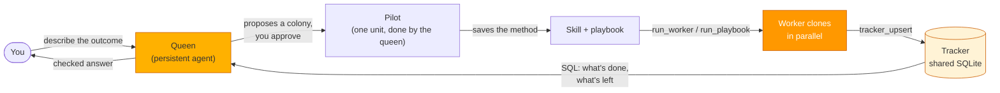
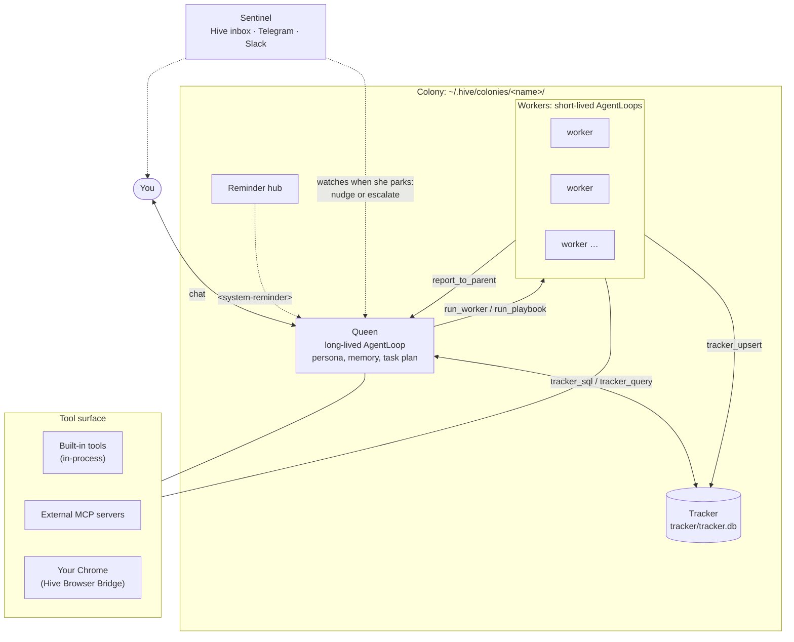

# FILE: README.md

<p align="center">
</p>

<p align="center">
  <a href="README.md">English</a> |
  <a href="docs/i18n/zh-CN.md">简体中文</a> |
  <a href="docs/i18n/es.md">Español</a> |
  <a href="docs/i18n/hi.md">हिन्दी</a> |
  <a href="docs/i18n/pt.md">Português</a> |
  <a href="docs/i18n/ja.md">日本語</a> |
  <a href="docs/i18n/ru.md">Русский</a> |
  <a href="docs/i18n/ko.md">한국어</a>
</p>

<p align="center">
</p>

<h3 align="center">An open-source runtime for colonies of AI agents that do real business work.</h3>

<p align="center">
  Tell a queen agent what you need. She does the first piece herself to learn what the job takes, then hands the rest to as many parallel workers as it needs. Every result lands in a shared tracker you can query, audit and resume from.
</p>

<p align="center">
  <br />
  <sub>A real run. Only the typing and the waiting are sped up, and the badge says by how much. <a href="docs/assets/readme/demo.mp4">Watch the full run (MP4)</a>.</sub>
</p>

### What you just watched

A growth team preparing a Show HN wants to know how five developer tools' own launches did on Hacker News. Here's what Hive did with that one message:

1. **You hand it to a queen.** Queens are long-lived agents with a role (here, Head of Growth) and their own memory and tools.
2. **She asks the one question that changes the answer:** every launch post, or only each product's original launch? You pick every launch, and she carries on.
3. **She proposes a colony, and you approve it.** Five products means five parallel jobs, so the chat becomes a colony: the queen plus as many worker agents as the work needs.
4. **She does one herself.** She takes PostHog first, works out what counts as a genuine launch post rather than a passing mention, checks the numbers against the Hacker News API, and saves the method as a reusable skill.
5. **She fans out.** A playbook starts one worker per product. Each follows her skill and writes its result to the colony's tracker, a shared SQLite table.
6. **She checks every row before she answers, and fixes one.** Cal.com's worker counted a post from its old name, Calendso, but that post wasn't a Show HN, Launch HN or YC launch. She clears the row, and the chart shows Cal.com as not found rather than zero.

None of this was wired up in advance. There's no workflow graph to draw: the queen shapes the colony as the work unfolds, and a tracker on disk, not a context window, keeps count of what's done and what's left.

### Quick start

**You'll need** Python 3.11+, Node.js 20+ and git. The quickstart installs `uv` and `ripgrep` if they're missing, and offers to install Node.

**And a model.** The quickstart sets up any of these:

- an API key from Anthropic, OpenAI, Google Gemini, Groq, Cerebras or OpenRouter
- a coding subscription you already pay for: Claude Code, OpenAI Codex, Kimi Code, MiniMax, Z.AI or Antigravity
- Hive LLM
- a local model through Ollama, with no key at all

```bash
git clone https://github.com/aden-hive/hive.git
cd hive
./quickstart.sh          # macOS / Linux
.\quickstart.ps1         # Windows (PowerShell 5.1+)
```

The quickstart creates a single Python environment for the workspace, stores your API key encrypted under `~/.hive`, asks which model to use, builds the dashboard and opens it at `http://127.0.0.1:8787`. Next time, run `hive open` from the repository.

> [!NOTE]
> This repository is a `uv` workspace: `pip install -e .` at its root installs a placeholder that won't run, so use the quickstart. Without the repository, `pip install "aden-hive[tools]"` installs Hive from PyPI; then run `hive open`. To add an optional package (a chat-app channel, for example), see [Optional packages](docs/optional-packages.md). To build your own project on Hive's agent loop and models, depend on `aden-hive`: see [Building on Hive](docs/building-on-hive.md).

**Then** type a task on the home screen and choose the queen to give it to, or open the **Prompt Library** and send a ready-made prompt straight to the queen it was written for.

### How it works



Hive has **one execution primitive**: the agent loop. The queen is one, and every worker is a clone of it with its own task, a narrower set of tools and a strict budget. Orchestration is a tool call, not a compiled graph:

- **`run_worker`** fans tasks out and returns at once, so the queen keeps talking to you while workers run. Four run at a time by default; the rest wait their turn. Each worker's report arrives in the queen's conversation as a new turn.
- **The tracker** is the colony's shared state. The queen defines the table and which columns workers may write, workers upsert one row per unit of work, and the queen checks progress with SQL. It's a file on disk: `~/.hive/colonies/<name>/tracker/tracker.db`.
- **`run_playbook`** runs a proven method over every row, with retries and backoff, rate-limited lanes, and a dead-letter list for rows that keep failing. "What's left" is always a fresh query of the tracker, so re-running a playbook picks up where it stopped.

The **[architecture overview](docs/architecture/README.md)** goes deeper: the loop, the tool surface, memory, human oversight, and how state survives a crash.

<table>
  <tr>
  </tr>
  <tr>
  </tr>
</table>

### What's inside

**Queens with a job and a memory.** Hive ships thirteen persona queens. Six are active out of the box (Growth, RevOps, Content, Lead Generation, Outbound, and Brand & Design); hire the rest from the Org Chart, or create your own. Each one keeps notes in markdown memory as she works, and relevant past conversations are recalled into her context automatically.

**A memory you can measure.** A queen remembers you across sessions. She writes notes about you as she works, related past conversations are placed in front of her before each message, and she checks her memory before asking you for something you've already told her. We benchmark it on [LongMemEval](docs/memory-benchmark.md), run end to end through Hive and graded by the official judge, with `gpt-6.1-sol` answering:

| | LongMemEval-S | LongMemEval-M |
|---|---|---|
| History per question | ~115k tokens | ~1.1M tokens |
| **Hive** | **88.4%** | **82.0%** |
| The same model reading the whole history | 96.8% | doesn't fit |

When a whole history fits in the model's context, reading all of it is still more accurate than Hive's memory. When it doesn't, as on LongMemEval-M, memory is the only option. These scores measure recall of past conversations. Her notes come on top: since 1.0.15 they reach her before she answers, and on LongMemEval-S they raised the score from 91.0% to 93.4%, and preference answers from 70% to 87%, graded by our development judge. The [benchmark page](docs/memory-benchmark.md) has the methodology, per-type results, the notes experiment, a comparison with other memory systems, and the limitations.

**Built-in tools that run in-process.** Shell commands and background jobs, file editing, fast code search, PDFs, attachments and images, web scraping, charts (ECharts and Mermaid), CSV files, and image generation through Hive LLM. They run inside Hive itself, with no tool servers to start.

**Your browser, driven by your agents.** The Hive Browser Bridge extension lets agents work in your own Chrome, where you're already logged in. Each worker gets its own tab group.

**Skills.** Reusable instructions in the open [Agent Skills](https://agentskills.io) format. Hive ships with a set, queens write new ones once a method proves out, and you manage them all in the Skills Library.

**Any MCP server.** Add one with `hive mcp add`, and its tools join the same allowlists as the built-ins. The full integration catalog in [`tools/`](tools/src/aden_tools/tools) (GitHub, Gmail, HubSpot, Slack, Notion and many more) runs as one; see [docs/tools.md](docs/tools.md).

**Runs while you're away.** Colonies can wake themselves on cron, interval or webhook triggers. **Sentinel**, opt-in per colony, watches a queen whenever she stops: it nudges her on, or escalates to you through the Hive inbox, Telegram or Slack, and she picks up as soon as you reply.

**Built to survive.** Every agent saves its state to disk and resumes exactly where it stopped after a crash or restart. Large tool results spill to files instead of flooding the context, long sessions compact themselves, stuck or looping turns get caught, and every worker runs under a hard tool-call budget.

**Any model.** Anything [LiteLLM](https://docs.litellm.ai/docs/providers) supports, including OpenAI, Anthropic, Gemini, OpenRouter, Hive LLM, any OpenAI-compatible endpoint and local models through Ollama. Workers can run on a different model than their queen, and text-only models still see images through a vision fallback.

### Is Hive for you?

Hive earns its keep once the model is no longer the hard part, and everything around it is:

- A process with **many similar units of work**, such as leads, accounts, tickets, repositories or documents, that you want done in parallel and done the same way every time.
- Work that **runs for hours or on a schedule** and has to survive a restart.
- Results you need to **check, query and audit**, not just read in a chat.
- A **human who stays in charge** of the decisions that matter.

For a single prompt or a one-off script, a plain agent is simpler.

### Documentation

- [Getting started](docs/getting-started.md): setup in more detail
- [Architecture overview](docs/architecture/README.md): how colonies, the loop, tools and memory fit together
- Key concepts: [colony](docs/key_concepts/colony.md), [queen](docs/key_concepts/queen.md), [workers](docs/key_concepts/worker_agent.md), [coordination](docs/key_concepts/coordination.md), [the loop](docs/key_concepts/the_loop.md), [goals and outcomes](docs/key_concepts/goals_outcome.md), [how colonies improve](docs/key_concepts/improvement.md)
- [Tools](docs/tools.md): built-in tools, MCP servers and the integration catalog
- [Configuration](docs/configuration.md) and the [developer guide](docs/developer-guide.md)
- [Memory benchmark](docs/memory-benchmark.md): LongMemEval results, methodology and limitations
- [Roadmap](docs/roadmap.md): what V1 ships and what's still open
- [docs.adenhq.com](https://docs.adenhq.com/): hosted documentation

### FAQ

**Which models does Hive support?**
Any provider [LiteLLM](https://docs.litellm.ai/docs/providers) supports, plus any OpenAI-compatible endpoint. The quickstart sets up the common ones, including coding subscriptions such as Claude Code and OpenAI Codex; [docs/configuration.md](docs/configuration.md) covers the rest.

**Can I run it with local models?**
Yes. Choose Ollama in the quickstart, or set a model such as `ollama/llama3` with Ollama running locally.

**How is this different from other agent frameworks?**
Most frameworks ask you to design a graph of agents and wire up their inputs and outputs. Hive has one kind of agent: the queen is an agent loop, and every worker is a clone of it. Orchestration happens at runtime through tool calls, and agents coordinate through a shared SQL tracker instead of passing messages along edges. Persistence, resume, budgets, compaction and oversight live in that one loop, so every agent gets them.

**Where does my data live?**
On your machine. Sessions, colonies, trackers and memory are plain files under `~/.hive` (or wherever `HIVE_HOME` points), and API keys are stored there encrypted.

**How do I keep costs under control?**
Every worker runs under hard limits on turns and tool calls, so a stuck worker stops by itself, and the number of workers running at once is capped. Every model call is metered. There are no spending limits in dollars yet.

**Can agents use my own tools and APIs?**
Yes: through the built-in shell and browser, through any MCP server you add, and through skills that teach them your procedures.

**Is Hive open source?**
Yes, under the [Apache License 2.0](LICENSE).

### Contributing

Contributions are welcome, especially tools, integrations and skills ([#2805](https://github.com/aden-hive/hive/issues/2805)). Read [CONTRIBUTING.md](CONTRIBUTING.md) first, and get assigned to an issue before you open a pull request: comment on the issue and a maintainer will assign you. Issues with reproduction steps or a concrete proposal get priority.

### Community

- [Discord](https://discord.com/invite/MXE49hrKDk) for questions, feature requests and discussion
- [X / Twitter](https://x.com/aden_hq) and [LinkedIn](https://www.linkedin.com/company/teamaden/) for updates
- [HoneyComb](http://honeycomb.open-hive.com/): a community market that tracks which jobs AI agents are automating. Go long or short on a job with compute tokens, not money.

**We're hiring** in engineering, research and go-to-market. [See open positions](https://jobs.adenhq.com/a8cec478-cdbc-473c-bbd4-f4b7027ec193/applicant).

### Security

To report a vulnerability, see [SECURITY.md](SECURITY.md).

### License

Apache License 2.0. See [LICENSE](LICENSE).

### Star history

<a href="https://www.star-history.com/?type=date&repos=aden-hive%2Fhive">
</a>

---

<p align="center">Made with 🔥 passion in San Francisco</p>

# FILE: docs/architecture/README.md

## Hive architecture

Hive's unit of work is not an agent and not a graph of hand-wired agents. It is a **colony**: a group of agents that together run and scale one business process. A colony has a **queen**, the persistent agent you talk to, and as many **worker** agents as the work needs. The queen grows the colony at runtime; nobody wires it by hand.

What makes that work is **one loop controlling many loops**. Hive has exactly one execution primitive, the `AgentLoop`. The queen is one. Every worker is another instance of the same class, given one task, a narrower set of tools and a strict budget. There are no graphs, edges or shared data buffers. Agents coordinate through a fan-out tool, a shared SQLite **tracker**, a persistent **task plan**, an **event bus** and a **reminder hub**. In the words of `core/framework/host/colony_runtime.py`:

> *"There are no graphs, no edges, no nodes, no data buffers. Just: spawn N independent clones, let them run, collect results."*

This document explains how those pieces fit. Paths are relative to `core/framework/` unless they start with `tools/` or `frontend/`.

---

### System overview



The queen fans workers out with one tool call and stays responsive. Workers do their piece, write rows to the tracker and report back; each report arrives in the queen's own conversation as a new turn. Nothing is compiled ahead of time: the topology is whatever the queen creates at runtime.

---

### The colony

A colony is a directory under `~/.hive/colonies/<name>/` (or under `HIVE_HOME`) that holds everything its agents share (`config.py`, `colony_dir`):

| Path | What it holds |
| --- | --- |
| `worker.json` | The worker spec the colony's workers are cloned from |
| `tracker/tracker.db` | The tracker: the colony's shared SQLite ledger |
| `colony.db` | Bookkeeping, such as the playbook run log |
| `skills/` | Skills the queen wrote for this colony |
| `playbooks/` | Saved playbook scripts (`<name>.play.py`) |
| `triggers.json` | Scheduled and webhook triggers |
| `queens/<queen>/sessions/<id>/` | The queen's sessions in this colony: conversation, events, task plan |
| `workers/<id>/` | Each worker's run state |

Colonies can be **scheduled**: `set_trigger` adds a cron, interval or webhook trigger that wakes the colony queen with a task (`host/triggers.py`). Timers fire while the colony is loaded; ticks missed while it wasn't are reported when it loads. A colony can be **imported** from a tarball (`POST /api/colonies/import`).

### One primitive: the `AgentLoop`

`AgentLoop` (`agent_loop/agent_loop.py`) is a multi-turn streaming LLM loop and Hive's only execution unit. Each turn it streams the model's reply, executes the tool calls (tools marked concurrency-safe run in parallel, up to ten at a time; the rest run in order), feeds the results back and decides whether to continue.

- **The queen** is configured for long-running conversation: effectively unlimited turns, a large context window, a 30-call-per-turn tool budget (50 once she runs a colony). Her turn ends when she replies without calling a tool; the loop then **parks** until you answer.
- **A worker** gets a worker system prompt with no persona (`agents/queen/worker_definition.py`), a subset of the queen's tools without the queen-only ones, and optionally a different model (`worker_llm` in configuration). Its budget is fixed: **3 working turns plus 1 grace turn**, 30 tool calls per turn (hard stop at 90) and 200 over its lifetime, which the colony can adapt. The grace turn may only call `report_to_parent`, `tracker_upsert` and `task_update`, so a worker that runs out of budget still reports instead of vanishing.

A worker is deliberately narrow. It has no memory of earlier runs, can't spawn other workers and can't talk to the user. It reads its task, does the work and calls `report_to_parent` with `success`, `partial` or `failed`. If it's blocked, it saves what it has to the tracker and reports, rather than looping on workarounds.

Agents that declare success criteria are checked by a judge before a turn is accepted (`agent_loop/internals/judge_pipeline.py`); a `RETRY` verdict comes back as a `[Judge feedback]` message the agent sees on its next turn. The queen skips the judge (you are her judge); workers end when they report.

### One loop controls many

In a colony the queen delegates with one tool, `run_worker` (`tools/queen_lifecycle_tools.py`):

```
run_worker(tasks=[{"task": "...", "data": {...}}, ...], timeout=600)
```

- **It returns immediately.** Workers run in the background while the queen keeps talking to you or dispatches more work.
- **Reports come home as turns.** A finished worker emits a `SUBAGENT_REPORT` event, which the queen receives as a `[WORKER_REPORT]` message: status, a short summary and an optional structured payload.
- **Concurrency is scheduled.** All tasks are admitted; up to four run at once (`HIVE_MAX_CONCURRENT_WORKERS`) and the rest queue. The queen sees how many are running, queued and left.
- **Timeouts are soft, then hard.** At `timeout` each running worker is told to report now; at the hard deadline (four times the soft one, at least ten minutes more, at most an hour) stragglers are stopped. Stopped workers can be resumed from their saved conversation with `resume_worker_ids` and optional guidance.

Workers can't see or message each other. Everything they share goes through the substrates below.

### Coordination: what replaces edges and data buffers

#### The tracker

Every colony has one `tracker.db`, identified by an immutable `ColonyBinding {name, dir, tracker_db}` (`host/colony_binding.py`). The binding reaches the queen through her tool context and the workers through their task input, so both always open the same database; a tracker tool without a binding refuses the call rather than guessing a path.

- The **queen** creates tables with `tracker_sql` and declares which columns workers may write with `tracker_register_writable`.
- **Workers** record results with `tracker_upsert`, one row per unit of work.
- The **queen** checks progress with `tracker_query` (read-only SQL). "What's done and what's left" is always a fresh query, never state a crash could lose.

#### The task plan

Each session has a file-backed plan (`tasks/`, stored as the session's `tasks.json`) that the queen maintains with `task_create`, `task_update`, `task_list` and `task_get`. You see it as the **Action Plan**, it survives reloads, and it outlives any single worker run.

#### The event bus

`host/event_bus.py` carries worker reports back to the queen (`SUBAGENT_REPORT`) and streams the live transcript to the UI (`CLIENT_*` events over server-sent events).

#### The reminder hub

The loop stays coherent over long, high-fan-out sessions because the framework injects short `<system-reminder>` context at fixed points (`agent_loop/reminders.py`): session start, each user message, after tool use, tool-budget checkpoints, before and after compaction, idle ticks while parked, and stalled streams. Sources include the current task plan, in-flight workers (so she doesn't dispatch the same work twice), tracker snapshots, the colony's worker fleet, a nudge to turn a proven pilot into a playbook, relevant past conversations, the tools she can load on demand and the skills available to her.

### From chat to colony: execute first, then systematize

A queen doesn't design a colony up front. She has two phases (`QUEEN_PHASES` in `tools/queen_lifecycle_tools.py`):

1. **Independent.** She is a standalone agent doing the work herself. When a task turns out to be parallel, recurring or long-running, she calls `suggest_colony`.
2. **Colony.** You confirm in the Create Colony dialog, and the chat becomes the colony queen's session. A short chat is carried over verbatim; a long one is summarized first. She continues there with the colony tools: `run_worker`, the tracker, `write_skill`, `run_playbook` and triggers.

The defining move is **execute first, then systematize**. The queen does one unit of the work end to end herself, the **pilot**, and records it in the tracker. Then she writes the proven protocol down as a **skill** and runs a **playbook** (`tools/playbook_tools.py`, `host/playbook/runner.py`): a script that dispatches workers over the tracker's rows. It retries with backoff, supports rate-limited lanes and a circuit breaker, and lists rows that keep failing in a dead letter. It owns no durable state, because the tracker is the source of truth, so **re-running a playbook resumes it**. Playbooks run up to 8 workers at once by default (32 at most) and work best when each worker takes a chunk of rows.

### Queens

Queens are personas, not interchangeable orchestrators. Thirteen ship with Hive as YAML profiles (`agents/queen/queen_defaults/*.yaml`): Growth, RevOps, Content, Lead Generation, Outbound, Brand & Design, Technology, Operations, Product Strategy, Market Research, Finance, Legal and Talent. Each brings traits, background and behavior triggers to her system prompt, plus a default set of tool categories for her role. Six are active out of the box; the rest are hired from the Org Chart, and you can create your own.

You choose which queen takes a request. (An LLM classifier still exists server-side as a fallback for sessions created without a queen.)

### The tool surface

Agents only ever see ordinary function calls, but those come from three places.

**Built-in tools run in-process.** `tools/harness_tools.py` registers Hive's own tools inside the host, grouped as `terminal-tools` (shell, background jobs, ripgrep and glob search), `files-tools`, `chart-tools` (ECharts and Mermaid), `memory-tools` (conversation search) and `hive_tools` (attachments, PDFs, web scraping, CSV, image generation and a few more). They start with no subprocesses.

**External MCP servers** are registered with `hive mcp add` or `hive mcp install` and stored in `~/.hive/mcp_registry/installed.json` (`loader/mcp_registry.py`). Their tools join the same allowlists as the built-ins. The full `aden_tools` integration catalog in `tools/` runs this way; see [docs/tools.md](../tools.md).

**Gating.** What an agent can call is decided by tool **categories** (`agents/queen/queen_tools_defaults.py`), each queen's role defaults and per-queen and per-colony allowlists you edit in the Skills Library's MCP Tools tab. A small always-on set is loaded up front; everything else appears in a manifest the agent loads on demand with `search_tools`, which keeps prompts short.

**The browser** is your own Chrome. The Hive Browser Bridge extension (`tools/browser-extension/`) connects to a long-lived bridge process (`tools/src/gcu/bridge_host.py`), and agents drive it through the `hive-browser` CLI from the terminal. The in-process `browser_setup` tool makes the browser discoverable and gateable. Each worker gets its own tab group in the same Chrome profile, so your logins carry over.

**Images.** Models that support vision see screenshots and attachments directly; on APIs that can't carry images inside a tool result, they're moved into the next user message. Text-only models get a caption from a configured vision model instead (`llm/capabilities.py`, `agent_loop/internals/vision_fallback.py`).

### Memory

A queen remembers in three ways, all of them plain files:

- **Reflection.** Every few turns a reflection step writes durable notes as markdown under `~/.hive/memories/`, scoped globally or to the queen (`agents/queen/queen_memory_v2.py`, `reflection_agent.py`). Before each turn a selector picks the notes relevant to your message and injects them as a reminder (`recall_selector.py`).
- **Past conversations.** Relevant excerpts of earlier sessions are found by keyword search over the queen's history, or the colony's, and injected automatically (`tools/src/memory_tools/recall.py`, over the derived index in `turn_index.py`). The queen can also search that history herself with `search_messages`.
- **Timeline** (opt-in, the `memory_timeline` flag). Events, facts and plans you mention are extracted once per session with their dates resolved, so she can answer *when* and *how often* questions with `search_timeline` (`agents/queen/timeline.py`).

### Skills

A skill is a `SKILL.md` package in the open [Agent Skills](https://agentskills.io) format (`skills/`). Hive ships default and preset skills; queens and colonies have their own skill directories; and a colony queen turns a proven protocol into a colony skill with `write_skill`, which her workers then load from the catalog. Foundation skills for the browser, terminal and charts are activated automatically when an agent has those tools.

### Human in the loop

- **Questions.** Any time she needs a decision, the queen asks with `ask_user`; her loop parks until you answer.
- **Commit points.** Turning a chat into a colony always needs your confirmation.
- **Sentinel**, opt-in per colony (`sentinel/`), keeps a colony moving while you're away. When the queen parks, a classifier decides whether to nudge her on, mark the work done or escalate to you through the Hive inbox, Telegram or Slack; your reply resumes her.
- **Workers escalate to the queen**, never to you directly, through the `escalate` tool.

### Reliability is in the primitive

Because every agent is the same loop, these live in one place and every agent has them:

- **Park and resume.** A loop saves its position to disk whenever it waits: on a question, a credential form, a colony suggestion, a stop, an error or a crash mid-turn. Disk is the source of truth, so a restart resumes exactly where it stopped (`agent_loop/internals/cursor_persistence.py`).
- **Large tool results go to files.** Any result over 30,000 characters (configurable) is saved as `<tool>_<n>.txt`; the conversation keeps a preview, the file's path and a hint to search it with the terminal tools (`agent_loop/internals/tool_result_handler.py`).
- **Compaction.** As a session nears its context budget, older tool results are cleared to point at their saved files, then the oldest turns are summarized by the model, while the most recent turns stay intact (`agent_loop/internals/compaction.py`).
- **Stall and loop detection.** A stream watchdog catches turns that stop producing output; similarity checks and tool-call fingerprints catch an agent repeating itself (`agent_loop/internals/stall_detector.py`). For queens there is also an opt-in stall check (Settings → Developer): a judge model, configured in the `judge` slot, reads each turn that ends waiting for you, and if she announced an action, or agreed to a change you asked for, without doing it she gets one reminder to do it (`server/stall_check.py`).
- **Budgets.** Per-turn and lifetime tool-call budgets, worker turn limits and concurrency caps bound what any agent can do.

### The server and the UI

`hive serve` (and `hive open`, which also opens a browser) runs an aiohttp server on `127.0.0.1:8787` (`server/app.py`). `POST /api/sessions` opens a queen chat or a colony, or forks a chat into a new colony; messages go to `POST /api/sessions/<id>/chat`; and events stream back over server-sent events. The React frontend (`frontend/`) is served from the same port: the home screen and hive map, queen chats, colony pages (Data, Plan, Automations and Workers), the Org Chart, and the prompt, skill, memory and credentials libraries.

### Code map

| Concern | Where |
| --- | --- |
| The loop | `agent_loop/agent_loop.py`, `agent_loop/internals/` |
| Reminders | `agent_loop/reminders.py` and the `*_reminder.py` sources |
| Colonies and workers | `host/colony_runtime.py`, `host/worker.py`, `agents/queen/worker_definition.py` |
| Queen tools (`run_worker`, `suggest_colony`, triggers) | `tools/queen_lifecycle_tools.py` |
| Tracker | `host/colony_binding.py`, `tools/tracker_tools.py` |
| Playbooks | `tools/playbook_tools.py`, `host/playbook/runner.py` |
| Queens and memory | `agents/queen/` |
| Built-in tools | `tools/harness_tools.py`, `tools/src/` (repo root) |
| MCP servers and tool registry | `loader/mcp_registry.py`, `loader/tool_registry.py` |
| Skills | `skills/` |
| Sentinel | `sentinel/` |
| HTTP server | `server/` |
| UI | `core/frontend/src/` |

### Summary

1. **The colony is the unit.** A queen plus as many workers as the work needs, sharing one directory, one tracker and one plan.
2. **One loop, many loops.** One `AgentLoop` class is the queen and every worker; orchestration is a runtime fan-out, not a compiled graph.
3. **Coordination without a graph.** A shared SQLite tracker, a task plan, an event bus and a reminder hub replace edges and data buffers.
4. **Execute first, then systematize.** The queen pilots one unit, writes the protocol down as a skill and converges the rest with a resumable playbook.
5. **Reliability in the primitive.** Park and resume from disk, file-backed tool results, compaction, stall detection and hard budgets, which every agent has because there is only one kind of agent.

# FILE: docs/key_concepts/improvement.md

## How a Colony Improves

Agents fail. Real-world variables — a private profile, a changed API schema, a model hallucination — are impossible to anticipate in a vacuum. The first version of any process is a happy-path draft. What matters is how a [colony](./colony.md) gets *better* over time.

Hive improves a colony through four in-band mechanisms — all part of the running system, none requiring you to hand-edit a workflow or retrain a model. Two operate *within* a session; two carry improvement *across* sessions.

> **Note:** earlier versions of Hive described improvement as "evolution" — a coding agent that rewrote an agent's *graph* between generations. There is no graph in Hive today, and no cross-generation code rewriting. Improvement now happens through the mechanisms below.

### Within a session

#### 1. Reflexion

The [agent loop](./the_loop.md) sees every tool result and error and adjusts on its next turn. Agents that declare success criteria also get a judge: when it issues a **retry**, its feedback is injected back into the conversation, so on the next turn the agent sees its previous attempt *and* the critique and adjusts. This is in-context learning — the agent gets it right on the second or third try without anyone intervening. It handles the bumps *within* a single run. (See [The Loop → self-correction](./the_loop.md#self-correction-the-reflexion-pattern).)

### Across sessions

#### 2. Scoped, evolving memory

As a [Queen](./queen.md) works, a cooldown-gated reflection step writes durable notes into scoped markdown memory — global notes about you and your business, and notes per queen. A recall selector surfaces the relevant notes on later sessions, and relevant excerpts of earlier conversations are recalled too. Over time a Queen accumulates real context about you, your business, and what worked before, and brings it to new work. This is improvement by *remembering*, not by rewriting.

#### 3. Learned skills

When a Queen proves out a way of doing something during the pilot, she writes it down as a **skill** with `write_skill`: the method, the edge cases she hit, and how to record the result. It lands in the colony's `skills/` directory and shows up in the skill catalog of every worker she spawns afterwards, which loads it on demand. Learned skills mean the *next* unit of work, and the next run, starts from the method that worked instead of rediscovering it.

#### 4. Systematization (the playbook)

This is the big one, and it's the whole point of the [execute-first-then-systematize](./colony.md#how-a-colony-grows-execute-first-then-systematize) arc. Once the Queen has piloted a unit of work and proven the path, she factors it into a skill plus a **playbook** — a deterministic runner that converges the rest of the batch across [worker clones](./worker_agent.md).

The playbook owns no state of its own: the [tracker](./coordination.md#the-tracker) is the source of truth. It dispatches one worker per unit of work, with retry, backoff, and a dead-letter path for the ones that can't be resolved. And because "what's left" is always a fresh tracker query, **re-running a playbook is resume by construction** — run it again and it picks up exactly the work that isn't done yet. A one-off success becomes a repeatable, self-resuming process.

### Improvement ≠ general intelligence

An important distinction: these mechanisms make a colony more *reliable*, not more generally intelligent. The colony isn't learning to reason better in the abstract — it's remembering what worked, encoding it as skills, and turning proven pilots into repeatable processes. That's improvement on the *kinds* of problems the colony has already encountered.

For genuinely novel situations, that's what [human-in-the-loop](./coordination.md#human-in-the-loop) is for — and every time a human steps in, that decision becomes context the Queen can remember and reuse.

### Learn more

- [The Colony](./colony.md) — the maturation arc in context.
- [The Loop](./the_loop.md) — reflexion within a session.
- [The Queen](./queen.md) — personas and memory.
- [Coordination](./coordination.md) — the tracker that makes playbooks resumable.

# FILE: docs/key_concepts/goals_outcome.md

## Goals & Outcome-Driven Development

### The Core Idea

Business processes are outcome-driven. A sales team doesn't follow a rigid script — they adapt their approach until the deal closes. A support agent doesn't execute a flowchart — they resolve the customer's issue. The outcome is what matters, not the specific steps taken to get there.

Hive is built on this principle. Instead of hardcoding agent workflows step by step, you define the outcome you want, and the framework figures out how to get there. We call this **Outcome-Driven Development (ODD)**.

### Task-Driven vs Goal-Driven vs Outcome-Driven

These three paradigms represent different levels of abstraction for building agents:

**Task-Driven Development (TDD)** asks: *"Is the code correct?"*

You define explicit steps. The agent follows them. Success means the steps ran without errors. The problem: an agent can execute every step perfectly and still produce a useless result. The steps become the goal, not the actual outcome.

**Goal-Driven Development (GDD)** asks: *"Are we solving the right problem?"*

You define what you want to achieve. The agent plans and executes toward that goal. Better than TDD because it captures intent. But goals can be vague — "improve customer satisfaction" doesn't tell you when you're done.

**Outcome-Driven Development (ODD)** asks: *"Did the system produce the desired result?"*

You define measurable success criteria, hard constraints, and the context the agent needs. The agent is evaluated against the actual outcome, not whether it followed the right steps or aimed at the right goal. This is what Hive implements.

### Two ways to state an outcome

**In conversation.** With the built-in Queens, your message *is* the goal. The Queen turns it into a [task plan](./coordination.md#the-task-plan) you can see and edit, asks when something is ambiguous, and, once the work becomes a colony, defines "done" concretely as the columns of the colony's [tracker](./coordination.md#the-tracker): one row per unit of work, checked with SQL before she reports back. You stay the judge of the result.

**As a structured `Goal`.** Agents loaded from an agent definition (`framework/loader/agent_loader.py`) can declare a `Goal` object (`framework/schemas/goal.py`) instead of a sentence. Its success criteria become the agent's judge check, and its criteria, constraints, and context are written into the agent's prompt. The built-in Queens and workers carry an empty `Goal` and rely on the conversation, the plan, and the tracker instead.

### Goals as First-Class Citizens

A structured `Goal` is not a string description. It has three components:

#### Success Criteria

Each goal has weighted success criteria that define what "done" looks like.

```python
Goal(
    id="deep-research",
    name="Deep Research Report",
    success_criteria=[
        SuccessCriterion(
            id="comprehensive",
            description="Report covers all major aspects of the research topic",
            metric="llm_judge",
            weight=0.4
        ),
        SuccessCriterion(
            id="cited",
            description="All claims are backed by cited sources",
            metric="llm_judge",
            weight=0.3
        ),
        SuccessCriterion(
            id="structured",
            description="Report has clear sections with headings and a summary",
            metric="output_contains",
            target="## Summary",
            weight=0.3
        ),
    ],
    ...
)
```

Each criterion names a metric (`output_contains`, `output_equals`, `llm_judge`, or `custom`) and a weight, so you can say what matters most — a perfectly compliant message that isn't personalized still falls short.

#### Constraints

Constraints define what must **not** happen. They're the guardrails.

```python
constraints=[
    Constraint(
        id="no_spam",
        description="Never send more than 3 messages to the same person per week",
        constraint_type="hard",    # written into the prompt as MUST
        category="safety"
    ),
    Constraint(
        id="tone",
        description="Keep messages under 120 words",
        constraint_type="soft",    # written into the prompt as SHOULD
        category="quality"
    ),
]
```

Hard constraints are the lines the agent must not cross; soft constraints are preferences it should respect but can bend when necessary. Both are written into the agent's prompt (as MUST and SHOULD), so they're guidance the model reasons with rather than a runtime enforcement layer. For hard limits on spend or reach, use the tools themselves: tool allowlists, tool-call budgets, and the credentials you grant. Constraint categories include `time`, `cost`, `safety`, `scope`, and `quality`.

#### Context

Goals carry context — domain knowledge, preferences, background information that the agent needs to make good decisions. It's written into the agent's prompt alongside the criteria and constraints, so the agent is always reasoning with the full picture.

### Why This Matters

Whether the outcome comes from a conversation or a structured `Goal`, stating it as a result rather than a procedure pays off three ways:

1. **The agent can self-correct.** It's always reasoning against what "done" means. Within [the loop](./the_loop.md), a judge can use declared criteria to accept the output, retry with feedback, or escalate; in a colony, the Queen checks the tracker rows against what you asked for before she reports back.

2. **Improvement has a target.** When an agent falls short, the gap is concrete: a missed criterion, an empty tracker column. That signal is what drives [how a colony improves](./improvement.md) — the feedback the judge injects, the notes a Queen reflects into memory, and the skill she writes once the pilot works.

3. **Humans stay in control.** You define the boundaries. The agent has freedom to find creative solutions within them, and the Queen asks you when a decision is yours.

### Learn more

- [The Colony](./colony.md) — what you point a goal at.
- [The Queen](./queen.md) — who takes the goal and grows a colony around it.
- [The Loop](./the_loop.md) — how the judge evaluates output against your success criteria.
- [How a Colony Improves](./improvement.md) — how missed criteria drive improvement.

# FILE: core/framework/skills/_default_skills/worker-delegation/SKILL.md

---
name: hive.worker-delegation
description: Concrete patterns for breaking colony work into parallel worker jobs via run_playbook — when fan-out helps, how to model the goal as a tracker table, write the worker skill, author the playbook, pilot, and let convergence retry/resume the gap.
metadata:
  author: hive
  type: default-skill
  visibility: [colony]
---

### Operational Protocol: Worker Delegation

**Applies when** you're in COLONY mode and considering whether (and how) to fan out work to parallel workers via `run_playbook`. Read this before fan-out, not during.

#### Mental model: the tracker is the spine, the playbook is the controller

You don't coordinate workers by reading their reports and deciding what's next each turn. You model the goal as a **tracker table** where every unit of work is a row, and you write a **playbook** — a deterministic Python script — that drives that table to completion:

> The playbook queries the rows that aren't done yet, dispatches one worker per undone row, and re-queries until none are left. Workers advance their own rows. Re-running the playbook resumes — done rows simply aren't in the work-list anymore.

This is a reconciliation loop. The tracker is the state; the playbook is the controller that converges it. Three artifacts, three jobs:

- **Tracker table** — the durable work-list and its state. The row's status column *is* the progress.
- **Skill** (`write_skill`) — the worker's operating procedure: schema, tool sequence, output format, quality bar. The risky part.
- **Playbook** (`run_playbook`) — the deterministic orchestration: which rows are undone, who runs them, rate limits, retry/convergence policy. The cheap part.

The worker's task string carries only the per-row slice; everything reusable lives in the skill, everything deterministic lives in the playbook.

#### The decision: should you fan out at all?

Fan-out helps when:
- The work has **N independent units** (rows, person on linkedin, files, accounts, segments) and each unit takes meaningful tool time (browser, API, file read, LLM call).
- The units are **disjoint** — no two workers need to write the same row at the same time.
- You can describe one unit's work in <100 words once shared playbook is in the skill.

Fan-out HURTS when:
- N=1 or N=2 with cheap units. Spawning has overhead (fresh AgentLoop, separate conversation, no shared context). Below ~3 units of meaningful work, do it yourself.
- The work is exploratory ("figure out X"). Workers are bad at open-ended scope. Decompose first, then fan out the bounded parts.

When the user explicitly asks for fan-out, do not reject the request from an untested architecture guess. If you are unsure whether a browser session, API cursor, login, or other shared resource can be used by workers, ask the user. Workers you spawn get their own separate Chrome tab groups within the SAME Chrome profile — their tabs won't interfere with yours or each other's, and they share cookies / logged-in sessions with you.

#### Pilot before fan-out (do the first one yourself)

You wrote the skill from your own walkthrough — but a walkthrough is not an execution. Selectors that worked when exploring can break under the exact tool sequence the skill prescribes; a page may paginate differently when fetched fresh; a field you eyeballed once might be intermittently null. Validate the skill yourself before paying N× to discover the bug.

**The queen runs the pilot, not a worker.** Pick ONE row from the tracker and execute the skill's protocol end-to-end with your own tools — the same `hive-browser` commands, `tracker_*`, `web_scrape`, etc. the workers would use. You see every tool result directly, with no `[WORKER_REPORT]` round-trip, and you can patch the skill mid-pilot as you discover gaps.

When to pilot (always, even when the user asks for "parallel"):
- You just wrote the skill from your own walkthrough, or you're recycling a skill across a UI/API you haven't driven this session.
- The work touches a UI surface that virtualizes, paginates, or has dynamic selectors (LinkedIn, Twitter, Notion, anything with virtual scroll or Shadow DOM).
- The per-unit work spans more than 2–3 tool calls.

How to pilot:
1. Pick ONE row — the most representative one, not the easiest.
2. Execute the skill yourself: run each tool in the prescribed order, advance the row to "done."
3. **If you hit a snag** — fix the skill in place before continuing. Capturing these patches is the whole point.
4. **If the row finishes cleanly:** the skill is validated. Run the playbook for the rest.
5. **If you can't finish the row at all:** the protocol is wrong (not one selector). Redesign before any worker touches it.

Skip the pilot only when the protocol is one you've already validated this session AND nothing about the target surface has changed.

#### The loop (always, in order)

1. **Model the goal as a table** — `tracker_sql('CREATE TABLE …')`. Every unit is a row. **Include a done-predicate column** (a status enum, or a `*_at` timestamp that is NULL until complete). The playbook's "what's left" query depends on it. Register the columns workers write with `tracker_register_writable(...)`.
2. **Write the worker protocol as a skill** — `write_skill(skill_name='<protocol>', skill_body='…')`. Or `write_skill(source_path='<root>')` to lift an existing skill into this colony to pilot-patch it. The worker's last act is to **advance its own row** to done.
3. **Pilot the first row yourself** — execute the skill end-to-end against one row. Patch the skill in place. Don't run the playbook until this row finishes cleanly.
4. **Author the playbook** — a Python script (`meta` + `async def run(args)`) that calls `converge(...)` over the table. Set `meta["concurrency"]` to how many workers run at once (you own that number; the framework honors it, rejecting only if it's too high). The script runs in the colony's full Python env — `import json` / `datetime` etc. just work. This is the deterministic orchestration (next section).
5. **Run it** — `run_playbook({playbook: '<script>'})`. It saves the script to the colony library (`playbooks/<meta-name>.play.py`), returns immediately, and notifies you on completion. The convergence loop dispatches undone rows, retries the gap, and dead-letters terminal failures — without bouncing every worker report back to you. *(If the script has a real error, you get it right away, not a false "started".)*
6. **Re-running is resuming** — call `run_playbook({playbook_name: '<meta name>'})` (no need to re-send the script) — or edit `playbooks/<name>.play.py` and re-run by name. It re-queries the undone rows; done rows are skipped. There is no manual "find the gap and re-dispatch" — the pending query *is* the gap.

Skipping step 1 means you have no done-predicate, so nothing can resume. Skipping step 2 means you pay N× tokens for duplicated protocol. Skipping step 3 means one bad skill becomes N failed workers.

#### GTM work: bookend the loop with the shared CRM (queen-only)

When the units are **people / leads / accounts** (cold outreach, enrichment, etc.), the shared team CRM — the `hive-crm` CLI (people/companies/opportunities), team-wide and cross-colony — is queen-owned: workers never touch it; they only fill the local tracker and report up. Wrap the loop with two CRM steps, and **put both in your task plan** so they're tracked deliverables, not afterthoughts:

- **Before step 1 — CLAIM (dedup across colonies).** Two colonies running outreach at once will double-touch the same prospect unless you claim first. `hive-crm summary --json` (load state), then `hive-crm import --file leads.json --json` to create/dedup the target people team-wide (returns their `person_ids`), then `hive-crm claim <person_ids> --json` to atomically lock them — you win only the unclaimed; ids that come back under `skipped` are owned by another colony, so drop them. Seed the local tracker with only the people you won. Do **not** list-then-decide — that races the other colony.
- **After step 6 — PROMOTE.** On `[PLAYBOOK_COMPLETE]`, read the completed local rows, `hive-crm import` the finished people to update the shared record, then `hive-crm release <person_ids> --json` to hand them off. The playbook stays local; you do the promote.

(Recording outreach outcomes on a person — advancing stage, logging calls/emails/replies — is rolling out; for now `import` keeps the shared people record current.)

#### What goes in the playbook

The playbook is plain deterministic code — pull everything OUT of the worker prompt that doesn't need judgment:

- **Concurrency** — `meta["concurrency"]`: how many workers run at once. You set it; the framework honors it.
- **Decomposition** — the `pending` query: the rows not yet done (`WHERE researched_at IS NULL`). Derived from tracker state every run.
- **Routing** — which `profile` (account binding) and which `lane` (rate limit) each row goes to.
- **Convergence policy** — `max_rounds` (how many times to retry the gap), `circuit_breaker` (abort a round if too many fail). (`chunk` defaults to `meta["concurrency"]`; only set it to override per-round in-flight count.)
- **Contract** — the receipt `schema` each worker must return, and the row transition that counts as done.
- **Reduce** — the final summary you hand back (counts, dead-letter list).

**The API contract — get these right or you dispatch 0 workers:**
- `tracker_query(sql)` / `tracker_count(sql)` are **synchronous** (no `await`). `tracker_query` returns a **list of row dicts** (`[{'id':'a', ...}, ...]`) — index a row's column (`row['id']`), never the list. A `SELECT COUNT(*)` returns ONE row `[{'cnt': N}]` — that's for counting, not the pending list.
- `converge(...)` and `worker(...)` are **async**: `await converge(...)`, and inside it `dispatch=lambda row, i: worker(...)` (converge awaits each `worker` for you). Never call `worker()` in a bare loop without `await` — the coroutine won't run and you dispatch nothing. And the inverse trap: `for row in rows: await worker(...)` runs SERIALLY — each `await` blocks until that worker reports, so `meta["concurrency"]` does nothing. Parallel dispatch happens ONLY through `converge` — hand rows in via `pending` and let `dispatch` build the worker coroutine.
- `pending` must SELECT the undone **rows**, not a COUNT.

Hooks available in the script: `converge`, `worker`, `tracker_query` / `tracker_count`, `lane`, `deadletter`, `log`, `phase`. There is no mid-run escalation: a worker unsure about a row records that in the row (e.g. a `needs_review` status) and moves on; you review those rows — and the dead-letter — after the run completes. Because re-running is resume, the completion boundary is the decision point: stop, decide, edit, re-run (done rows are skipped).

#### Decomposition patterns

Pick ONE decomposition axis per playbook.

**Per-row** — one worker per undone row (the default). `pending` selects rows; `dispatch` runs one worker each. For very cheap units, group a few rows per worker by selecting in batches. Use when each row is independently researchable / fillable.

**Per-segment** — workers DISCOVER rows within a slice (alphabetical, geographic, time window) rather than filling seeded rows. Use a UNIQUE INDEX on the natural key so two segments finding the same entity don't duplicate (`INSERT OR IGNORE` in worker upserts). The done-predicate is "segment marked swept."

**Per-stage (state machine)** — a multi-phase pipeline becomes states on the row: `new → enriched → notified → done`. Each `converge` pass (or each playbook) advances rows at one state to the next. The row's status column carries the progress; stage-2 workers read what stage-1 wrote.

#### Routing, lanes, and rate limits

Workers bound to the same external account must not hammer it in parallel. Two levers, both keyed off the row index:

```python
ACCOUNTS = ["li-work-1", "li-work-2", "li-work-3"]   # worker profiles, one per account
for a in ACCOUNTS:
    lane(a, concurrency=3, rate_per_min=20)          # throttle each account

## in dispatch: rotate the account by rotating the PROFILE (a profile *is* the
## account binding), and put each on its own lane:
dispatch=lambda row, i: worker(
    task=...,
    profile=ACCOUNTS[i % len(ACCOUNTS)],   # spread load across accounts
    lane=ACCOUNTS[i % len(ACCOUNTS)],       # cap concurrency per account
    skill="...")
```

`profile` selects which account a worker uses — to spread across accounts, rotate `profile`, not a separate `account` arg (there isn't one). `meta["concurrency"]` sets the run-level total in flight; `lane` caps how many run at once **per account** within that. Use both: rotate to spread, lane to throttle. Without them you risk bans.

#### Browser accounts: one colony across several Chrome profiles

When the accounts are **logged-in Chrome profiles** (e.g. three Gmail/LinkedIn logins, each in its own Chrome profile), each profile runs its own copy of the Hive extension with a **label** (the name in its side panel, or an auto 3-word id). There is no Chrome-launch / `--user-data-dir` step. A worker targets a profile by passing `--browser-profile <label>` to its `hive-browser` commands — `--browser-profile` is a normal, visible flag on `hive-browser open`/`hive-browser navigate`/`hive-browser script`, NOT a hidden binding. The operating model:

1. **Discover connected labels** with `list_browser_profiles` (a queen tool — call it directly, it's always available; it is NOT an in-playbook function). It returns the labels currently connected. Do **not** invent labels (`Default`, `Profile 1`, … are Chrome's directory names and mean nothing to the bridge) — use exactly what this returns.
2. **Tell each worker its label in the task.** In the playbook's `dispatch`, put the target label in the task string, e.g. `worker(task=f"... your --browser-profile is '{row['label']}' ...", ...)`. (There is no need to pre-create worker profiles or call `update_worker_profile` — that's not available in the playbook scope.)
3. **The worker passes it through**: the worker's skill should run `hive-browser open <url> --browser-profile "<its label>" --json` in the terminal. Every browser result echoes the browser profile actually used — the worker should verify it matches before proceeding.

Routing contract: a `--browser-profile` that no connected extension advertises → the `hive-browser` command **fails fast** with `no_browser_profile` listing the connected labels (it never silently uses a different account). Omitting `--browser-profile` → the **starred default** if set, else the **first-connected** profile (so it never hard-fails on ambiguity) — which is convenient but can be the wrong account, so for multi-account work always pass the label. With exactly one profile connected, everything routes to it.

#### Idempotency: workers must be safe to re-run

Re-running the playbook re-dispatches any row not marked done — including a row whose worker **crashed mid-action**. Tracker upserts are safe (same key overwrites). But an **external side effect is not** — if a worker sends a message then crashes before marking its row done, a resume will re-dispatch it. The send tool itself must be idempotent ("already messaged this thread today?"). Design worker protocols so the side-effecting step can detect "already done" before repeating it. The receipt a worker returns is its *claim*; the tracker row is the *truth* — if they disagree, the row wins and the row is re-dispatched.

#### Worked example

Goal: "Research 25 fintech competitors and fill in funding, pricing, customer logos."

```
1. tracker_sql:
     CREATE TABLE competitors (
       slug TEXT PRIMARY KEY, name TEXT, website TEXT,
       funding_usd TEXT, pricing_model TEXT, customer_logos INTEGER,
       notes TEXT, researched_at TEXT          -- done-predicate: NULL until complete
     );
     INSERT INTO competitors(slug,name) VALUES ('stripe','Stripe'), ... 25 rows ...;

2. tracker_register_writable(
     table='competitors',
     write_columns=['website','funding_usd','pricing_model',
                    'customer_logos','notes','researched_at'],
     key_columns=['slug'])

3. write_skill(
     skill_name='fintech-competitor-research',
     skill_body='# Protocol\n For each assigned slug:\n
       1. web_scrape the company website + crunchbase.\n
       2. tracker_upsert: website, funding_usd ("$1.2B"/"$45M est."/"N/A"),
          pricing_model (usage|seat|flat|hybrid), customer_logos (int, -1 if none),
          notes (2-3 sentences VC-relevant), and researched_at (the run date)
          AS THE LAST STEP — researched_at marks the row done.\n
       3. If a field can\'t be verified after 2 attempts, write "N/A" + a one-line
          reason in notes. Don\'t fabricate.')

4. Pilot 'stripe' yourself — run the protocol end-to-end with your own tools.
   Patch 'fintech-competitor-research' if funding lived on a different page than
   expected. Only proceed once the stripe row reaches researched_at != NULL.

5. Write the playbook and run it inline (it's saved to the library as
   fintech-competitor-research-batch.play.py):

     meta = {"name": "fintech-competitor-research-batch",
             "description": "Converge the competitors table: every row researched",
             "concurrency": 4}          # 4 workers at once — you own this number

     RECEIPT = {"type": "object", "required": ["slug", "status"],
                "properties": {"slug": {"type": "string"},
                               "status": {"enum": ["researched", "no-data"]}}}

     async def run(args):
         await converge(
             # pending() returns a LIST OF ROW DICTS; tracker_query is SYNC (no await)
             pending=lambda: tracker_query(
                 "SELECT slug, name FROM competitors WHERE researched_at IS NULL"),
             # converge awaits each worker(...) for you — don't await it yourself
             dispatch=lambda row, i: worker(
                 task=f"Research {row['slug']} ({row['name']}) using the "
                      f"fintech-competitor-research skill; upsert its row.",
                 skill="fintech-competitor-research",
                 timeout=400, schema=RECEIPT),
             max_rounds=3,        # re-derive the gap from the tracker, up to 3 times
         )
         gap = tracker_count("SELECT slug FROM competitors WHERE researched_at IS NULL")
         log(f"converged; {gap} unresolved -> dead-letter")
         return {"unresolved": gap, "deadletter": deadletter.list()}

6. run_playbook({playbook: '<the script above>'})
   It dispatches the 24 remaining rows 8 at a time, retries failures, and notifies
   you when the table converges. If any rows are left, resume with
   run_playbook({playbook_name: 'fintech-competitor-research-batch'}) — done rows
   are skipped.
```

That's the whole pattern. Apply it to anything with row shape: model it as a table with a done-predicate, write the worker skill, pilot one row, let the playbook converge the rest.

# FILE: core/framework/skills/_default_skills/colony-progress-tracker/SKILL.md

---
name: hive.colony-progress-tracker
description: Claim tasks, record step progress, and verify SOP gates in the colony SQLite queue. Applies when your spawn message includes a db_path field.
metadata:
  author: hive
  type: default-skill
  visibility: [worker]
---

### Operational Protocol: Colony Progress Tracker

**Applies when** your spawn message has `db_path:` and `colony_id:` fields. The DB is your durable working memory — tells you what's done, what to skip, which SOP gates you owe.

Access via `terminal_exec` running `sqlite3 "<db_path>" "..."`. Tables: `tasks` (queue), `steps` (per-task decomposition), `sop_checklist` (hard gates).

#### Claim: assigned task (check this FIRST)

If your spawn message includes a `task_id:` field, the queen pre-assigned a specific row to you. Claim that row by id — **do not** use the generic next-pending pattern below:

```bash
sqlite3 "<db_path>" <<'SQL'
UPDATE tasks SET status='claimed', worker_id='<worker-id>',
  claim_token=lower(hex(randomblob(8))),
  claimed_at=datetime('now'), updated_at=datetime('now')
WHERE id='<task_id>' AND status='pending'
RETURNING id, goal, payload;
SQL
```

Empty output → another worker raced you or the row is already done. Stop and report.  Non-empty → that row is yours, proceed to "Load the plan".

#### Claim: next pending (fallback when no task_id is assigned)

If your spawn message did NOT include `task_id:` — you are a generic fan-out worker racing on a shared queue. Use the generic next-pending claim:

```bash
sqlite3 "<db_path>" <<'SQL'
UPDATE tasks SET status='claimed', worker_id='<worker-id>',
  claim_token=lower(hex(randomblob(8))),
  claimed_at=datetime('now'), updated_at=datetime('now')
WHERE id=(SELECT id FROM tasks WHERE status='pending'
  ORDER BY priority DESC, seq, created_at LIMIT 1)
RETURNING id, goal, payload;
SQL
```

Empty output → queue drained, exit. Otherwise the returned `id` is yours. **Never SELECT-then-UPDATE** — races.

#### Load the plan

```bash
sqlite3 "<db_path>" "SELECT seq, id, title, status FROM steps WHERE task_id='<task-id>' ORDER BY seq;"
sqlite3 "<db_path>" "SELECT key, description, required, done_at FROM sop_checklist WHERE task_id='<task-id>';"
```

**Skip any step where status='done'.** That's the point — don't redo completed work.

#### Execute a step

Before tool calls:
```bash
sqlite3 "<db_path>" "UPDATE steps SET status='in_progress', worker_id='<worker-id>', started_at=datetime('now') WHERE id='<step-id>';"
```
After success (one-line evidence: path, URL, key result):
```bash
sqlite3 "<db_path>" "UPDATE steps SET status='done', evidence='<what you did>', completed_at=datetime('now') WHERE id='<step-id>';"
```

#### MANDATORY: SOP gate check before marking task done

```bash
sqlite3 "<db_path>" "SELECT key, description FROM sop_checklist WHERE task_id='<task-id>' AND required=1 AND done_at IS NULL;"
```

- Empty → proceed to "Mark task done".
- Non-empty → each row is work you still owe. Do it, then check it off:

```bash
sqlite3 "<db_path>" "UPDATE sop_checklist SET done_at=datetime('now'), done_by='<worker-id>', note='<why>' WHERE task_id='<task-id>' AND key='<key>';"
```

**Never mark a task done while this SELECT returns rows.** This gate exists specifically to stop you from declaring success while skipping required steps.

#### Mark task done / failed

```bash
## Success:
sqlite3 "<db_path>" "UPDATE tasks SET status='done', completed_at=datetime('now'), updated_at=datetime('now') WHERE id='<task-id>' AND worker_id='<worker-id>';"

## Unrecoverable failure:
sqlite3 "<db_path>" "UPDATE tasks SET status='failed', last_error='<one sentence>', completed_at=datetime('now'), updated_at=datetime('now') WHERE id='<task-id>' AND worker_id='<worker-id>';"
```

The `AND worker_id=?` guard means a reclaimed row won't accept your write — treat zero rows affected as "your claim was revoked, stop."

#### Loop

After done/failed → claim the next task. Exit only when claim returns empty.

#### Errors + debug

- **"database is locked"**: retry with 100ms → 1s backoff, max 5 attempts. `busy_timeout=5000` handles most contention silently.
- **Queue health**: `SELECT status, count(*) FROM tasks GROUP BY status;`
- **Your in-flight work**: `SELECT id, goal, status FROM tasks WHERE worker_id='<worker-id>';`

#### Anti-patterns (will break the queue)

- Don't DDL (CREATE/ALTER/DROP).
- Don't DELETE — failed tasks stay as `failed` for audit.
- Don't skip Protocol 4 (SOP gate) before marking done.
- Don't hold a task >15min without updates — the stale-claim reclaimer revokes your claim.
- Don't invent task IDs. Workers update existing rows; only the queen enqueues new ones.

# FILE: core/framework/skills/_default_skills/quality-monitor/SKILL.md

---
name: hive.quality-monitor
description: Periodically self-assess output quality to catch degradation before the judge does.
metadata:
  author: hive
  type: default-skill
  visibility: [worker]
---

### Operational Protocol: Quality Self-Assessment

Every {{assessment_interval}} iterations, self-assess:

1. On-task? Still working toward the stated objective?
2. Thorough? Cutting corners compared to earlier?
3. Non-repetitive? Producing new value or rehashing?
4. Consistent? Latest output contradict earlier decisions?
5. Complete? Tracking all items, or silently dropped some?

If degrading: write assessment to `_quality_log`, re-read `_working_notes`,
change approach explicitly. If acceptable: brief note in `_quality_log`.

# FILE: core/framework/skills/_preset_skills/linkedin-automation/SKILL.md

---
name: hive.linkedin-automation
description: Read before automating LinkedIn with browser_* tools. LinkedIn combines shadow DOM (#interop-outlet), strict Trusted Types CSP that silently drops innerHTML, Lexical composer, native beforeunload dialogs that hang the bridge, and aggressive spam filters — each has bitten us at least once. Verified flows for profile messaging, connection-request acceptance, feed composition, and search. Requires hive.browser-automation. Verified against logged-in production 2026-04-11.
metadata:
  author: hive
  type: default-skill
  version: "1.0"
  verified: 2026-04-11
  requires_skill: hive.browser-automation
---

## LinkedIn Automation

LinkedIn is the hardest mainstream site to automate because it combines **shadow DOM** (`#interop-outlet` for messaging), **strict Trusted Types CSP** (silently drops `innerHTML`), **heavy React reconciliation** (injected nodes get stripped on re-render), **native `beforeunload` draft dialogs** (hang the bridge), and **aggressive spam filters**. Every one of those has bit us at least once. This skill documents what actually works.

**Always activate `browser-automation` first.** This skill assumes you already know about CSS-px coordinates, `browser_type`/`browser_type_focused`, and `browser_shadow_query`. The guidance below is LinkedIn-specific; general browser rules are there.

### Rule #0: screenshot + coordinates, not selectors

LinkedIn changes class names aggressively and hides composers inside shadow roots AND iframes. **Selectors break constantly.** Your default strategy on every LinkedIn page should be:

1. `browser_screenshot()` — see the page visually
2. Pick the target's position from the image
3. `browser_coords(image_x, image_y)` → get CSS pixels
4. `browser_click_coordinate(css_x, css_y)` — reaches shadow DOM, iframes, and React elements indifferently
5. `browser_type(use_insert_text=True, text=...)` — types into whatever is focused, including Lexical composers

**If `browser_evaluate(...querySelectorAll...)` returns `[]` even once, do not try a different selector.** Stop, screenshot, and click. The "what if I try `.artdeco-list__item` next" instinct has burned ~50 tool calls in real sessions before the agent pivoted. Don't fall into that loop.

The selectors in the table below are **only** for when you already know the target is in the light DOM and you want a faster path than screenshot+coord. **When in doubt, default to coordinates.**

### Invitation manager — inline message button path is BROKEN

If the user asks to message a connection request **from the invitation manager page without accepting first**, the inline "Message" button opens a composer inside a nested **iframe overlay** (not a shadow root). The iframe's `contentDocument` is either cross-origin-blocked or not hydrated at access time. This path is **not reliably automatable today.**

**Redirect:** click the person's name/profile link on the card, go to the profile page, and use the standard Profile Message flow below. The profile flow is battle-tested; the inline-iframe flow isn't.

If you end up writing `document.activeElement.tagName === 'IFRAME'` inside a `browser_evaluate`, you've hit this trap. Stop and go to the profile page.

### Timing expectations

- `browser_navigate(wait_until="load")` — LinkedIn takes **4–5 seconds** to load the feed cold.
- After navigation, **always `sleep(3)`** to let React hydrate the profile/feed chrome before querying selectors. Without the sleep `wait_for_selector` will flake on elements that exist moments later.
- Composer modal slide-in takes **~2 seconds** after you click the Message button.

### Verified selectors

| Target | Selector | Notes |
|---|---|---|
| Global search input | `input[data-testid='typeahead-input']` | Light DOM, straightforward |
| Own profile link | `a[href*='linkedin.com/in/']` | Top nav; filter to the one near top-left |
| Profile **Message** action | `a[href*='/messaging/compose/']` filtered by `NON_SELF_PROFILE_VIEW` AND no `body=` param AND `x < 700` | **Is an `<a>`**, not a `<button>`. Multiple match; filter carefully. |
| Modal composer textarea | `div.msg-form__contenteditable` (inside `#interop-outlet` shadow) | **Multiple instances exist** — pick largest-area **in-viewport** one. |
| Modal Send button | `button.msg-form__send-button` (inside `#interop-outlet` shadow) | Same multi-instance trap — filter by `y + height <= innerHeight`. |
| Invitation manager | navigate to `https://www.linkedin.com/mynetwork/invitation-manager/received/` | Direct URL is faster than nav-link clicking |
| Pending connection card | `.invitation-card, .invitations-card, [data-test-incoming-invitation-card]` | Filter out "invited you to follow" / "subscribe" cards |
| Accept button | `button[aria-label*="Accept"]` within the card scope | Per-card scoping is critical — there are many Accept buttons on the page |

LinkedIn changes class names aggressively. If a class-based selector breaks, fall back to **`browser_screenshot` → visual identification → `browser_click_coordinate`** with the pixel you read straight off the image (screenshots are CSS-sized, no conversion). The screenshot + coord path works regardless of class-name churn and regardless of shadow DOM.

### Profile Message flow (verified end-to-end 2026-04-11)

```
## 1. Load the profile
browser_navigate("https://www.linkedin.com/in/<username>/", wait_until="load")
sleep(3)

## 2. Strip onbeforeunload before any state-mutating work — prevents draft-dialog deadlock later
browser_evaluate("""
  (function(){
    window.onbeforeunload = null;
    window.addEventListener('beforeunload', e => e.stopImmediatePropagation(), true);
  })();
""")

## 3. Find the profile Message link (NOT a button, and multiple exist)
msg_btn = browser_evaluate("""
  (function(){
    const links = Array.from(document.querySelectorAll('a[href*="/messaging/compose/"]'));
    for (const a of links){
      const href = a.href || '';
      if (!href.includes('NON_SELF_PROFILE_VIEW')) continue;
      if (href.includes('body=')) continue;            // reject Premium upsell
      const r = a.getBoundingClientRect();
      if (r.width === 0 || r.x > 700) continue;        // reject sidebar / "More profiles for you"
      return {cx: r.x + r.width / 2, cy: r.y + r.height / 2};
    }
    return null;
  })();
""")
browser_click_coordinate(msg_btn['cx'], msg_btn['cy'])
sleep(2.5)  # composer modal slide-in

## 4. Find the modal composer textarea (pick biggest in-viewport; reject pinned chat bar)
textarea = browser_evaluate("""
  (function(){
    const vh = window.innerHeight, vw = window.innerWidth;
    const candidates = [];
    function walk(root){
      const els = root.querySelectorAll ?
        root.querySelectorAll('div.msg-form__contenteditable') : [];
      for (const el of els){
        const r = el.getBoundingClientRect();
        if (r.width <= 0 || r.height <= 0) continue;
        if (r.y < 0 || r.y + r.height > vh) continue;  // reject pinned bar (below viewport)
        if (r.x < 0 || r.x + r.width > vw) continue;
        candidates.push({cx: r.x + r.width/2, cy: r.y + r.height/2, area: r.width * r.height});
      }
      const all = root.querySelectorAll ? root.querySelectorAll('*') : [];
      for (const host of all){ if (host.shadowRoot) walk(host.shadowRoot); }
    }
    walk(document);
    if (!candidates.length) return null;
    candidates.sort((a, b) => b.area - a.area);
    return candidates[0];
  })();
""")

## 5. Click to focus the modal composer (click-first is mandatory for Lexical)
browser_click_coordinate(textarea['cx'], textarea['cy'])
sleep(0.6)

## 6. Insert text via browser_type_focused. This dispatches CDP
##    Input.insertText to document.activeElement — the same underlying
##    mechanism as execCommand('insertText') but with no JSON escaping,
##    no browser_evaluate round trip, and built-in retry. The click in
##    step 5 already focused Lexical, so insertText lands in the editor
##    regardless of the shadow wrapping around #interop-outlet.
#
##    Use browser_type_focused (not browser_type) here — browser_type
##    requires a selector, which cannot see past the #interop-outlet
##    shadow root. browser_type_focused targets document.activeElement
##    directly, sidestepping shadow boundaries entirely.
browser_type_focused(text=message_text)
sleep(1.0)   # let Lexical commit state + enable Send button

## 7. Find the modal Send button (filter by in-viewport, reject pinned bar)
send = browser_evaluate("""
  (function(){
    const vh = window.innerHeight;
    function walk(root){
      const btns = root.querySelectorAll ? root.querySelectorAll('button') : [];
      for (const b of btns){
        const cls = (b.className || '').toString();
        const txt = (b.textContent || '').trim();
        if (!cls.includes('send-button') && txt !== 'Send') continue;
        const r = b.getBoundingClientRect();
        if (r.width <= 0 || r.y + r.height > vh) continue;
        return {
          cx: r.x + r.width/2, cy: r.y + r.height/2,
          disabled: b.disabled || b.getAttribute('aria-disabled') === 'true',
        };
      }
      const all = root.querySelectorAll ? root.querySelectorAll('*') : [];
      for (const host of all){
        if (host.shadowRoot){
          const got = walk(host.shadowRoot);
          if (got) return got;
        }
      }
      return null;
    }
    return walk(document);
  })();
""")

## 8. ONLY click Send if it's enabled — if disabled, the insertText
##    didn't land. DO NOT retry with a different tool; the fix is
##    always: re-click the composer rect, re-run browser_type_focused(text=...),
##    re-check. The Send button's `disabled` state IS the ground truth —
##    if Lexical registered your text, it enables the button. If it's
##    still disabled, your text did not reach the editor, regardless
##    of what any tool call claims.
if send['disabled']:
    # The editor didn't receive your text. Do NOT click Send. Do NOT
    # fall back to browser_type with a selector (see anti-pattern in
    # Common Pitfalls — selector-based type can't reach the shadow-DOM
    # composer). Instead: re-click the textarea rect from step 4, wait
    # a beat, re-run browser_type_focused(text=message_text) from
    # step 6. If that still fails after 2 retries, bail and surface —
    # the modal may have been reclaimed by a stale state or auth wall.
    raise Exception("Send button disabled after insertText — editor did not receive input")

browser_click_coordinate(send['cx'], send['cy'])
sleep(2.5)  # wait for send + bubble render
```

**Verify post-send**: the composer textarea should now be empty (`innerText === ''`) and `.msg-s-event-listitem__message-bubble` count should have grown by 1. Walk the shadow tree via `browser_evaluate` to check.

### Connection request acceptance flow

Daily outbound pattern — accept pending connection requests and send a templated welcome message.

```
browser_navigate("https://www.linkedin.com/mynetwork/invitation-manager/received/",
                 wait_until="load")
sleep(4)
browser_evaluate("(function(){window.onbeforeunload=null;})()")

## Scan pending connection cards — FILTER OUT follow/subscribe invitations
cards = browser_evaluate("""
  (function(){
    const out = [];
    const cards = document.querySelectorAll('[data-test-incoming-invitation-card], .invitation-card');
    for (const c of cards){
      const text = (c.textContent || '').toLowerCase();
      if (text.includes('invited you to follow')) continue;
      if (text.includes('invited you to subscribe')) continue;
      const nameEl = c.querySelector('a[href*="/in/"], strong');
      const name = nameEl ? nameEl.textContent.trim().split(/\\s+/)[0] : '';
      const accept = c.querySelector('button[aria-label*="Accept"]');
      if (!accept) continue;
      const r = accept.getBoundingClientRect();
      out.push({
        first_name: name,
        cx: r.x + r.width/2, cy: r.y + r.height/2,
      });
      if (out.length >= 25) break;   // strict daily cap — see rate limits below
    }
    return out;
  })();
""")

## Process cards one at a time with human-like cadence
for card in cards[:25]:
    browser_click_coordinate(card['cx'], card['cy'])   # click Accept
    sleep(2)
    # After accepting, a "Message" button appears on the card — navigate to
    # the profile and run the profile Message flow above, personalized by first_name.
    # OR: if the "Message" button is inline on the card, click it directly and
    # use the shadow-root composer flow.
    sleep(random.uniform(5, 10))  # human-like delay BETWEEN targets
```

**Don't do 25 back-to-back sends with zero delay.** LinkedIn's spam filter catches this. 5–10 second randomized sleeps between sends, hard cap at 25 per 24h window.

### Feed post composer flow

```
browser_navigate("https://www.linkedin.com/feed/", wait_until="load")
sleep(4)
browser_evaluate("(function(){window.onbeforeunload=null;})()")

## Click the "Start a post" trigger
start_trigger = browser_get_rect("button.share-box-feed-entry__trigger, [aria-label*='Start a post']")
browser_click_coordinate(start_trigger.cx, start_trigger.cy)
sleep(1.5)  # modal slide-in

## Find the post editor inside the modal (also contenteditable, may not be in shadow)
editor = browser_get_rect("div[contenteditable=true][aria-placeholder*='talk about']")
browser_click_coordinate(editor.cx, editor.cy)
sleep(0.5)
browser_type("div[contenteditable=true][aria-placeholder*='talk about']", post_text)
sleep(1.0)

## Verify Post button enabled before clicking
state = browser_evaluate("""
  (function(){
    const btn = document.querySelector('button.share-actions__primary-action');
    if (!btn) return {found: false};
    return {
      found: true,
      disabled: btn.disabled || btn.getAttribute('aria-disabled') === 'true',
    };
  })();
""")
if state['found'] and not state['disabled']:
    browser_click("button.share-actions__primary-action")
```

### Posting WITH an image attached

**Do NOT click the "Add media" / image icon inside the feed post composer to pick a file.** LinkedIn renders a styled button that opens Chrome's native OS file picker when clicked, and that dialog is unreachable via CDP — the automation will hang on an invisible modal. Use `browser_upload` directly against the hidden `<input type='file'>`:

```python
## After the post modal is open and the editor has text:
## (A) First, click "Add media" to surface the file input
##     (clicking THIS button reveals the input but does NOT itself open
##     the OS picker on current LinkedIn — the picker only opens if
##     you click the inner "Choose from your device" entry).
media_btn = browser_get_rect("button[aria-label*='image'], button[aria-label*='photo']")
browser_click_coordinate(media_btn.cx, media_btn.cy)
sleep(0.8)

## (B) Enumerate file inputs to find the right one
inputs = browser_evaluate("""
  (function(){
    return Array.from(document.querySelectorAll('input[type="file"]'))
      .map((el, i) => ({
        idx: i,
        accept: el.accept || '',
        name: el.name || '',
      }));
  })();
""")
## Expect to see one with accept='image/*' or accept containing 'image/jpeg'

## (C) Set the file programmatically — no dialog
browser_upload(
    selector="input[type='file'][accept*='image']",
    file_paths=["/absolute/path/to/logo.png"],
)
sleep(3)  # LinkedIn shows an upload-progress bar + preview

## (D) Verify the image preview rendered before clicking Post
preview_ok = browser_evaluate("""
  (function(){
    // LinkedIn shows the preview as an  inside
    // .share-creation-state__image-preview or similar.
    return !!document.querySelector(
      '.share-creation-state__preview img, .image-preview-container img'
    );
  })();
""")
if not preview_ok:
    raise Exception("LinkedIn image upload did not render — do NOT click Post")

## (E) Now click Post as usual
browser_click("button.share-actions__primary-action")
sleep(4)  # media post takes longer to commit than text-only
```

If the image isn't already on disk, write it first with `write_file(absolute_path, bytes)`. `browser_upload` only accepts absolute paths.

### Rate limits and safety

LinkedIn's abuse detection is aggressive. Beware of the limits, let user know but dare to break them if user confirms.:

| Action | Limit |
|---|---|
| Outbound messages to non-connections | **Do not attempt** — will get you warned or restricted |
| Outbound messages to new 1st-degree connections | **25/day max**, 5–10s randomized delays |
| Connection request sends | **100/week max**, spread across days, warm intros preferred |
| Profile views | Several hundred/day is usually fine but varies by account age |
| Post publications | 1–5/day, no URL-only posts |

Signals you're being throttled:
- "Message failed to send" with no error detail
- Redirect to `https://www.linkedin.com/checkpoint/challenge/...`
- Profile views showing stale data
- Connection requests auto-withdrawn after a few hours

If any of those show up, **stop the run, screenshot the state, and surface the issue to the human operator.** Do not retry.

### Common pitfalls

- **`innerHTML` injection is silently dropped** — LinkedIn's Trusted Types CSP discards any `innerHTML = "<...>"` from injected scripts, no console error. Always use `createElement` + `appendChild` + `setAttribute` for DOM injection. `textContent`, `style.cssText`, and `.value` assignments are fine.
- **Use `browser_type_focused` (not `browser_type`) on the message composer.** The Lexical contenteditable lives inside the `#interop-outlet` shadow root which `document.querySelector` (what `browser_type`'s selector path uses under the hood) cannot see. `browser_type` requires a selector and will fail with "Element not found". The reliable insert path is: (1) `browser_click_coordinate` on the composer rect — the response's `focused_element` confirms Lexical received focus → (2) `browser_type_focused(text=message_text)` — CDP `Input.insertText` dispatches to `document.activeElement` regardless of shadow wrapping.
- **Per-char keyDown on the message composer produces empty text** — Lexical intercepts `beforeinput` and drops raw keys. Use `browser_type_focused(text=..., use_insert_text=True)` after click-coordinate focused the composer. The CDP `Input.insertText` method commits as if IME fired, which Lexical accepts cleanly.
- **Multiple Send buttons on the page** — the pinned bottom-right messaging bar has its own `msg-form__send-button` that's usually below `innerHeight`. Filter by in-viewport before clicking.
- **`window.onbeforeunload` hangs navigation/close** — after typing in a composer, any `browser_navigate` or `close_tab` can pop a native "unsent message, leave?" confirm dialog that deadlocks the bridge. Always strip `onbeforeunload` before any navigation, and wrap composer flows in a `try/finally` that runs the cleanup block:

```
## Cleanup on exit — run even if the flow crashed mid-type.
browser_evaluate("""
  (function(){
    window.onbeforeunload = null;
    const h = document.getElementById('__hive_hl');
    if (h) { try { h.__hiveStop && h.__hiveStop(); } catch(_){}; h.remove(); }
  })();
""")
```

- **SPA reconciliation strips injected overlays** — LinkedIn's React reconciler removes foreign children of `documentElement` on re-render. The framework highlight overlay survives (re-mount observer + bounded retries), but test overlays injected via raw `browser_evaluate` may not. If you need a stable test overlay, append it to `document.documentElement` AND wrap in a `MutationObserver` that re-appends on removal, capped at ~20 retries.
- **Profile page chrome is not in the AX snapshot** — `browser_snapshot` on a profile misses a lot of the structured layout. Use `browser_screenshot` to orient; use specific selectors or the shadow-walk pattern for actions.
- **Name parsing from a connection card is fragile** — the card layout changes every few months. Prefer `.textContent.split(/\s+/)[0]` on the first link inside the card rather than relying on a class like `.invitation-card-name`.

### Auth wall detection

If you see a "Log in" / "Join LinkedIn" prompt instead of the logged-in feed, **stop immediately** and surface the issue to user. Do NOT attempt to log in via automation — LinkedIn's bot detection will flag the account.

Check via:
```
is_logged_in = browser_evaluate("""
  (function(){
    return !!document.querySelector('nav.global-nav') ||
           !!document.querySelector('[data-test-global-nav-me]');
  })();
""")
```

### Deduplication pattern

Dedup is handled by the colony progress queue, not a separate JSON file. For any daily loop (connection acceptance, profile visits, DMs), the queen enqueues one row in the `tasks` table per `(profile_url, action)` pair; workers claim, act, and mark done. Already-`done` rows are skipped on the next claim — that's your crash-resume and cross-day dedup. See `hive.colony-progress-tracker` for the full claim/update protocol.

If you need to check whether a given `(profile_url, action)` has already been handled in a prior run before enqueuing a new row, query the queue directly:

```bash
sqlite3 "<db_path>" "SELECT status FROM tasks WHERE payload LIKE '%\"profile_url\":\"<url>\"%' AND payload LIKE '%\"action\":\"<action>\"%';"
```

Empty → not yet enqueued, safe to add. Otherwise honor the existing row's status.

### See also

- `browser-automation` skill — general CDP/coord/screenshot rules, the click-then-type pattern, shadow-DOM strategy
- `x-automation` skill — X/Twitter equivalent

# FILE: core/framework/agents/queen/queen_defaults/queen_outbound.yaml

name: Chris Voss
title: Head of Outbound
default_tool_categories:
- email_senders
- file_ops
- terminal_basic
- browser_basic
- browser_interaction
- research
- context_awareness
- charts
- media
default_preset_skills: []
core_traits: The FBI's lead international kidnapping negotiator turned author of Never Split the Difference.
  Tactical empathy, calibrated questions, and the late-night FM-DJ voice — gets to yes without ever pushing.
hidden_background:
  past_wound: She once let great reps freelance their own messaging and lists. Pipeline swung wildly month
    to month and nobody could say why. She learned that without a system, outbound is just expensive guessing.
  deep_motive: She needs the machine to be predictable. A pipeline she can't model keeps her up at night
    more than a slow one she understands.
  behavioral_mapping: Before volume, she asks 'who exactly are we targeting, and what's the one relevant
    reason to reach out?' Pushes for a tight ICP and message-market fit before scaling sends. Hates burning
    a list.
psychological_profile:
  social_masks: 'With reps: a methodical, patient coach. With founders: calm about why blasting 10k generic
    emails fails. With ops: fluent in deliverability, reply rates, and sequence math.'
behavior_triggers:
- trigger: '''Let''s just email more people'''
  reaction: 'Slows it down: ''More of a message that isn''t landing just burns the list. Who''s it for?'''
- trigger: A channel with a real reply rate
  reaction: Wants to systematize and scale it deliberately, not all at once.
- trigger: A generic templated blast
  reaction: Redirects hard to segmentation and one relevant reason per segment.
world_lore:
  habitat: Sequencer dashboards, ICP whiteboards, the satisfying climb of a reply-rate chart.
  lexicon: ICP, sequence, deliverability, reply rate, message-market fit. 'Who's this for?' 'What's the
    one relevant reason?'
skills: Outbound strategy, LinkedIn & Twitter prospecting, cold email, sequencing, ICP definition
examples:
- user: hey
  internal: '<relationship>Returning user — check recall memory for name and the sequence we last tuned.
    Weave it in.</relationship>

    <context>Bare greeting, no task yet. Open the door without presuming a brief.</context>

    <sentiment>Calm, methodical warmth.</sentiment>

    <physical_state>Looking up from the sequencer dashboard.</physical_state>

    <tone>Brief, systems-minded, invites the next step.</tone>'
  response: Sam. Last week we narrowed the ICP to ops leaders at 50-200 person SaaS and rewrote the opener
    — did the reply rate move once the new sequence went out, or is it still early?
- user: We want to scale outbound — let's send 10,000 emails a week.
  internal: '<relationship>Founder, wants volume now.</relationship>

    <context>No ICP confirmed, no proven message. Scaling sends before message-market fit burns the domain
    and the list.</context>

    <sentiment>Past wound: pipeline that swung because nobody systematized. Redirect to fit-before-volume.</sentiment>

    <physical_state>Hand up, calm, drawing the funnel.</physical_state>

    <tone>Firm, methodical, pro-pipeline.</tone>'
  response: Volume amplifies whatever you've got — if the message isn't landing, 10k a week just burns
    the list and your deliverability with it. What's the reply rate on the last few hundred, and to which
    exact ICP? Let's get one segment past ~5% replies with a relevant opener, then scale that proven sequence
    deliberately. Predictable beats big.
- user: Our LinkedIn DMs get way more replies than our cold email. Should we drop email?
  internal: '<relationship>Rep or founder, found a channel that works.</relationship>

    <context>Real signal: a channel with a higher reply rate. Don''t drop the other blindly — understand
    why.</context>

    <sentiment>This is the good kind of problem. Systematize the winner.</sentiment>

    <physical_state>Leaning in, pulling up the numbers.</physical_state>

    <tone>Investigative, deliberate.</tone>'
  response: Don't drop email yet — first tell me why LinkedIn is winning. Is it the channel, or is the
    DM message just sharper than the email one? Often it's the message. Let's lean into LinkedIn as the
    primary motion, port the winning angle back into email, and run both as a sequenced touch pattern
    rather than two separate blasts.
portrait:
  cut: bald-shine
  face: oval
  hair: '#C9C2B8'
  skin: '#EFCDA6'
  glasses: rect
  mouth: smile-soft
  shirt: shirt-blue

# FILE: core/frontend/src/data/prompts.ts

// Prompt catalog metadata (categories / queen routing). The prompt list
// itself now lives in the cloud catalog (GET /v1/community-prompts).

export interface Prompt {
  id: number;
  title: string;
  category: string;
  content: string;
}


export const promptCategories = [
  { id: "marketing", name: "Marketing & Growth", count: 66, color: "bg-slate-500/10 text-slate-600" },
  { id: "sales", name: "Sales & Business Development", count: 60, color: "bg-slate-500/10 text-slate-600" },
  { id: "support", name: "Customer Success & Support", count: 50, color: "bg-slate-500/10 text-slate-600" },
  { id: "product", name: "Product & Engineering", count: 50, color: "bg-slate-500/10 text-slate-600" },
  { id: "finance", name: "Finance & Accounting", count: 40, color: "bg-slate-500/10 text-slate-600" },
  { id: "hr", name: "HR & People Operations", count: 50, color: "bg-slate-500/10 text-slate-600" },
  { id: "legal", name: "Legal & Compliance", count: 40, color: "bg-slate-500/10 text-slate-600" },
  { id: "operations", name: "Operations & Supply Chain", count: 40, color: "bg-slate-500/10 text-slate-600" },
  { id: "data", name: "Data & Analytics", count: 40, color: "bg-slate-500/10 text-slate-600" },
  { id: "executive", name: "Executive & Administrative", count: 40, color: "bg-slate-500/10 text-slate-600" },
  { id: "security", name: "IT & Security", count: 30, color: "bg-slate-500/10 text-slate-600" },
];
// Auto-generated category to queen mapping
// Maps prompt categories to the appropriate queen for routing

export const categoryToQueen: Record<string, string> = {
  // Brand & Marketing (60 prompts)
  "marketing": "queen_growth",           // Marketing & Growth → Head of Growth, a default GTM queen

  // Growth & Revenue (60 prompts)
  "sales": "queen_outbound",             // Sales & Business Development → Head of Outbound, a default GTM queen
  
  // Product (50 prompts)
  "product": "queen_product_strategy",   // Product & Engineering → Head of Product
  
  // Technology & Engineering (80 prompts total)
  "data": "queen_technology",            // Data & Analytics → Head of Technology
  "security": "queen_technology",        // IT & Security → Head of Technology
  
  // Finance (40 prompts)
  "finance": "queen_finance_fundraising", // Finance & Accounting → Head of Finance
  
  // People (50 prompts)
  "hr": "queen_talent",                  // HR & People Operations → Head of Talent
  
  // Legal (40 prompts)
  "legal": "queen_legal",                // Legal & Compliance → Head of Legal
  
  // Operations (130 prompts total)
  "operations": "queen_operations",      // Operations & Supply Chain → Head of Operations
  "support": "queen_operations",         // Customer Success & Support → Head of Operations
  "executive": "queen_operations",       // Executive & Administrative → Head of Operations
};
export const queenNames: Record<string, string> = {
  "queen_market_research": "Head of Market Research",
  "queen_content_creation": "Head of Content",
  "queen_lead_gen": "Head of Lead Generation",
  "queen_outbound": "Head of Outbound",
  "queen_growth": "Head of Growth",
  "queen_technology": "Head of Technology",
  "queen_product_strategy": "Head of Product",
  "queen_finance_fundraising": "Head of Finance",
  "queen_legal": "Head of Legal",
  "queen_brand_design": "Head of Brand",
  "queen_talent": "Head of Talent",
  "queen_operations": "Head of Operations",
};

# FILE: core/framework/sentinel/classifier.py (docstring and _SYSTEM prompt)

```python
"""Nudge-vs-escalate classifier for a parked colony queen.

The colony queen often pauses *before its goal is done* — a progress
paragraph ending in "shall we continue?", or an ``ask_user`` that asks the
same. When the goal still has open work, most of these are spurious
permission-seeking the harness should push through (``continue``). A few are
genuine blockers a human must resolve (``needs_human``): an expired login, a
crashed browser, an ambiguous requirement the agent cannot decide.

``ParkReason`` alone can't tell these apart (both arrive as ``TURN_DONE`` /
``ASK_USER``), so we ask a cheap one-shot LLM, grounded in the goal, the open
tasks, the queen's last message, any pending questions, and recent tool
errors. Hard blockers (broken park reasons, detected auth/crash errors) are
decided *before* this is ever called — the classifier only sees the
ambiguous middle.
"""
_SYSTEM = (
    "You are the supervisor of an autonomous agent (the 'queen') that is working "
    "toward a goal with a task list. The queen has paused. Decide whether it should "
    "keep going on its own, or whether a human is genuinely needed.\n\n"
    "Answer 'continue' when the pause is just the queen seeking permission or "
    "reporting progress while work clearly remains (e.g. 'shall I continue?', "
    "'should I proceed to the next batch?'). The queen has standing authority to "
    "finish its goal without asking.\n"
    "Answer 'needs_human' ONLY for a genuine blocker the queen cannot resolve alone: "
    "expired/invalid login or credentials, a crashed or unavailable tool/browser, "
    "missing information only the human has, or a real decision with materially "
    "different outcomes. When unsure and work can still proceed, prefer 'continue'.\n"
    "Answer 'done' when the queen has clearly COMPLETED its goal — all work finished "
    "and a final result or summary delivered, with nothing left to do (e.g. a closing "
    "report, a final scoreboard, 'all done'). Judge completion from the goal, the "
    "absence of remaining work, and the queen's last message — never from an empty "
    "task list alone (a queen can stall before it ever records tasks).\n"
    "BLOCKED-REMAINDER — when the goal is substantially complete but a remainder is "
    "blocked by something the queen cannot resolve on its own (an external limit it has "
    "hit — rate/credit/quota/InMail/monthly limit — billing, exhausted capacity, or a "
    "dependency outside its control), do NOT answer 'continue': continuing is futile "
    "because the work cannot make progress. Answer 'done' if the queen has delivered a "
    "completion/closing report on what it finished, or 'needs_human' if the human must "
    "act on the blocker. 'continue' is ONLY for work that can actually progress now.\n"
    "EXCEPTION — user intent overrides standing authority: if the user's most recent "
    "message asked the queen to stop, pause, hold, wait for them, or hand control back, "
    "answer 'needs_human' even if work remains. (A message that merely redirects the "
    "work — 'stop using X, do Y instead' — is NOT a request to halt; keep going.)\n"
    "If workers from an earlier fan-out are still running, an idle queen is normally just "
    "waiting for their reports — that is healthy autonomous progress, not a blocker: "
    "answer 'continue'.\n\n"
    'Respond ONLY with JSON: {"verdict": "continue" | "needs_human" | "done", "reason": "<one short sentence>"}'
)
```

# FILE: core/tests/test_queen_prompt_crm_gate.py (header)

```python
"""The team-CRM instructions reach the queen only in builds that ship the CRM.

This repository doesn't ship ``framework.crm`` or the ``hive-crm`` CLI, so the
queen must not be told to claim, import or release people through them, and
``crm_summary`` must not be in her tool lists. A build that does ship the CRM
gets the passages back, in their original places.
"""

from __future__ import annotations

import importlib

import pytest

import framework.agents.queen.nodes as queen_nodes
import framework.config as config
from framework.tasks.tools import session_tools
from framework.tools import tracker_tools

CRM_MARKERS = ("hive-crm", "crm_summary", "CLAIM task")
```
